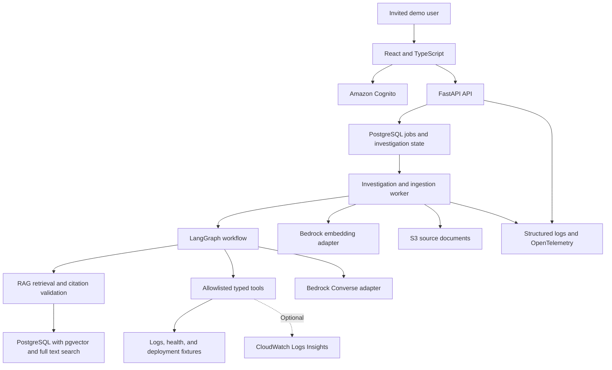
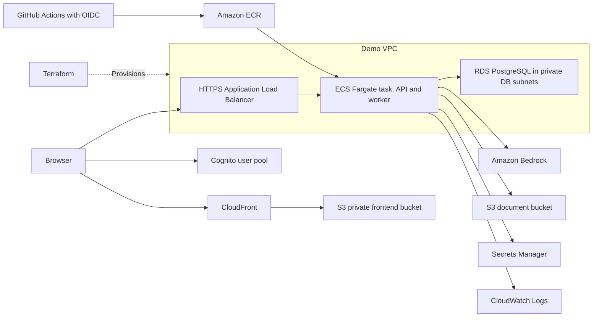
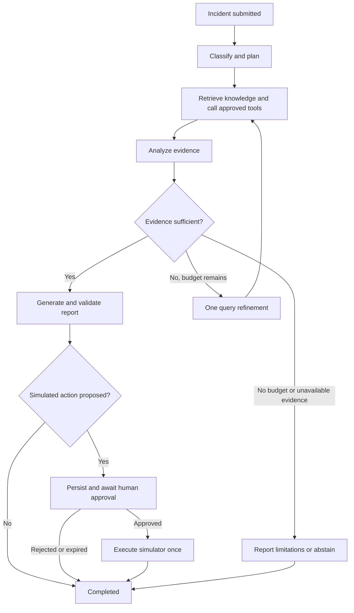

# CloudOps AI — Agentic RAG + AWS

> An eight-week project plan for an evidence-grounded incident investigation platform.

| Field | Plan |
| --- | --- |
| Suggested repository | `cloudops-ai-agent` |
| Suggested file location | `docs/PROJECT_PLAN.md` |
| Status | Planned; implementation and measured results are not yet available |
| Duration | 8 weeks, approximately 8–12 hours per week |
| Learning emphasis | 70% hands-on engineering; 30% architecture and evaluation |
| Primary stack | React, FastAPI, LangGraph, PostgreSQL/pgvector, Amazon Bedrock, ECS Fargate |
| Document updated | November 16, 2026 |

> [!IMPORTANT]
> **Revision, 2026-11-17: OpenTelemetry Demo direction.** This revision overrides
> conflicting parts of the original plan below.
>
> - **Reference system.** The project now uses the
>   [OpenTelemetry Demo](https://opentelemetry.io/docs/demo/) instead of the
>   fictional five-service organization (`api-gateway`, `user-service`, …) in
>   Sections 1, 2, and 8. The first focus is the demo's **checkout flow**.
>   Checkout's direct dependencies were verified in source (`src/checkout/main.go`):
>   cart, currency, email, payment, product-catalog, and shipping, plus an optional
>   Kafka producer. Shipping calls quote. Later weeks investigate checkout failures.
> - **Knowledge corpus.** Nine official demo documentation pages (architecture,
>   Docker deployment, and checkout-path services), copied unmodified under
>   CC BY 4.0 with recorded provenance. See `datasets/corpus/README.md`. The
>   synthetic runbooks and fixtures planned for Week 1 are not created.
> - **Week 1 scope.** Week 1 now delivers the local application foundation and
>   the document corpus only: no RAG inference, investigation workflow, job
>   queue, worker process, provider mocks, or cloud deployment. See the
>   revised Week 1 entry in Section 7.
> - **Evaluation.** The fixed 40-case design in Section 8 is replaced by
>   real-labeled cases that grow with the corpus. Week 1 contains a few
>   development cases. The held-out set must be designed and frozen before
>   retrieval or prompt tuning (Week 3). Incident families and fixtures for
>   checkout failures will be defined from the demo's own behavior, and fault
>   scenarios and expected root causes stay outside the retrieval corpus.
> - **Repository.** The repository is `cloudops-ai`. Its layout grows only as
>   features are implemented. The tree in Section 5 is the target, not the
>   current state.
> - **License.** The project license is undecided. No license file is added
>   until the owner chooses one.

This plan preserves the architecture and scope of the original project discussion and expands the milestones, acceptance criteria, and engineering details into an executable roadmap. All quality thresholds and spending limits below are proposed project targets, not achieved results or AWS price guarantees. Repository paths describe files to build; this document does not imply that those files already exist.

## Contents

- [1. Project goals](#1-project-goals)
- [2. Scope and release boundaries](#2-scope-and-release-boundaries)
- [3. Architecture and data flow](#3-architecture-and-data-flow)
- [4. Technology stack and decisions](#4-technology-stack-and-decisions)
- [5. Repository structure](#5-repository-structure)
- [6. Data and API contracts](#6-data-and-api-contracts)
- [7. Eight-week implementation roadmap](#7-eight-week-implementation-roadmap)
- [8. Evaluation strategy and metrics](#8-evaluation-strategy-and-metrics)
- [9. Security and human approval](#9-security-and-human-approval)
- [10. AWS cost control](#10-aws-cost-control)
- [11. Delivery, operations, and risks](#11-delivery-operations-and-risks)
- [12. Portfolio deliverables and completion checklist](#12-portfolio-deliverables-and-completion-checklist)

## 1. Project goals

Build an application that investigates incidents by combining technical knowledge with operational evidence. A user describes a failure; the system retrieves runbooks, queries approved tools, compares evidence, and produces a cited investigation report.

The project should demonstrate that its author can:

1. Implement a RAG pipeline from parsing through retrieval and citation validation.
2. Build a bounded, stateful agent workflow with typed tools and recoverable execution.
3. Deploy a containerized application on AWS using infrastructure as code and short-lived credentials.
4. Measure answer quality, retrieval quality, reliability, latency, and cost.
5. Explain architecture choices, limitations, and a credible path to larger deployments.

### Flagship demonstration

**Input:** “Our API started returning 500 errors after deployment. Investigate the issue and suggest a fix.”

**Expected experience:**

1. Select the affected service and incident time window.
2. Retrieve the relevant deployment runbook and historical incident.
3. Query application logs, service health, and recent deployments.
4. Correlate a configuration change with the start of errors.
5. Produce a likely cause, supporting evidence, alternative explanations, missing evidence, and proposed remediation.
6. Display the tool timeline and source citations in the UI.
7. If a simulated change is proposed, pause for an authenticated human decision.

The report must distinguish observations from hypotheses. “Insufficient evidence” is a valid result. Confidence labels must include a short evidence-based explanation; they are not calibrated probabilities.

## 2. Scope and release boundaries

The baseline is a single-agent application for one synthetic organization, with a small set of named services and invited demo users. Multiple services are represented by fixtures, not five separately deployed applications.

| Capability | Week 6 MVP | Week 8 portfolio release |
| --- | --- | --- |
| Markdown and text-based PDF ingestion | Required; small files only | Versioning, deletion, and failure handling verified |
| RAG answers with source citations | Required | Vector and hybrid retrieval compared |
| Five typed investigation tools | Required with fixtures | Optional real CloudWatch log adapter |
| Bounded LangGraph investigation | Required | Restart recovery and failure tests |
| React investigation UI | Required | Approval and evaluation summary views |
| AWS deployment and Terraform | Required | Reproducible deployment and teardown evidence |
| Authentication and resource authorization | Required before cloud access | Negative authorization tests |
| CI/CD | Basic tested deployment | Rollback exercise and release evidence |
| Evaluation | Development baseline | Frozen test results and comparison report |
| Human approval | Changes unavailable | Persisted approval for simulated remediation |
| Observability | Structured logs and health checks | Traces, latency, usage, and cost summaries |

**Out of scope:** production remediation, arbitrary shell execution, multi-agent coordination, Kubernetes, multi-cloud deployment, enterprise tenancy, OCR, fine-tuning, and a generic enterprise integration platform.

**Stretch work, only after release gates pass:** reranking, Bedrock Knowledge Bases comparison, BridgeLayer MCP adapter, streaming updates, and a redesigned low-fixed-cost public deployment. Real CloudWatch integration is recommended but does not block the baseline release.

## 3. Architecture and data flow

### Logical architecture



### AWS deployment topology



**Local development:** Docker Compose runs the API, worker, and PostgreSQL/pgvector; Vite serves the frontend. Local storage and deterministic mock providers keep development usable without AWS credentials. Real embedding and model calls are enabled explicitly for quality evaluation.

**Short-lived AWS demo:** use one Fargate task containing API and worker containers built from the same backend image. Use a public ALB across two public subnets and a Single-AZ RDS instance with a DB subnet group across two Availability Zones. RDS is not publicly accessible. This is a cost-conscious demo, not a highly available production deployment.

To avoid a NAT Gateway in the short-lived demo, place the Fargate task in a public subnet with a public IP and internet route. Allow inbound application traffic only from the ALB security group; allow database ingress only from the task security group. Public IPv4 still costs money. A production alternative uses private application subnets with deliberately priced NAT or VPC endpoints. Fargate connectivity requirements are documented in [AWS task networking](https://docs.aws.amazon.com/AmazonECS/latest/developerguide/fargate-task-networking.html).

Use a private S3 REST origin with CloudFront Origin Access Control for frontend assets, following [AWS S3 origin access guidance](https://docs.aws.amazon.com/AmazonCloudFront/latest/DeveloperGuide/private-content-restricting-access-to-s3.html). Reserve a domain or subdomain and provision an ACM certificate for the ALB API hostname before Week 6; document any DNS costs. CloudFront may use its default HTTPS hostname. Restrict API CORS to the deployed frontend origin.

### Ingestion flow

1. Authenticate an administrator; validate file type, size, and document scope.
2. Store the original privately and create a persisted ingestion job.
3. Extract Markdown or PDF text; reject encrypted, scanned, or unsupported files with a clear status.
4. Split by headings and paragraphs. Start with approximately 500-token chunks and 75-token overlap; tune on the development set.
5. Embed through a dedicated embedding adapter; store model identifier, vector dimensions, chunker version, content hash, document version, and page or heading location.
6. Build the vector and lexical representations; activate a document version only after ingestion succeeds.
7. Deduplicate repeated uploads. Deletion removes active chunks and source access; retained audit records must not expose deleted text.

Use the same embedding configuration for documents and queries. A model or dimension change requires a separate index/version and re-embedding. Mock embeddings validate plumbing only; they cannot support retrieval-quality claims. Bedrock embedding requests use the model-specific inference interface, not Converse; see [Titan embedding documentation](https://docs.aws.amazon.com/bedrock/latest/userguide/titan-embedding-models.html).

### Retrieval flow

Start with exact vector search for the small corpus. Add PostgreSQL full text search and Reciprocal Rank Fusion (RRF) in Week 3. Retrieve up to 20 candidates from each branch, merge, and send the top 5 chunks to the model. These are starting configurations, not universal defaults.

Apply service, document-version, and user-access filters within each query before ranking and fusion. Preserve error codes and configuration keys in lexical indexing; test identifiers such as `DB_POOL_TIMEOUT` explicitly. Only add an approximate vector index after measuring a need. The [pgvector project](https://github.com/pgvector/pgvector) documents exact search, approximate indexes, and hybrid retrieval options; [PostgreSQL full text search](https://www.postgresql.org/docs/current/textsearch.html) covers the lexical branch.

Every citation must resolve to an authorized, retrieved source ID and immutable version. Validate citation existence in code and assess whether it supports the claim during evaluation. A valid URL alone does not prove grounding.

### Agent workflow



LangGraph supplies explicit state and control flow; persistent checkpoints and interrupts support resuming work. See the [LangGraph overview](https://docs.langchain.com/oss/python/langgraph/overview) and [interrupt documentation](https://docs.langchain.com/oss/python/langgraph/interrupts).

Initial limits: 6 model calls, 8 tool calls, 1 query-refinement pass, 15 seconds per operational tool, and 120 seconds of active investigation time. Human waiting time is excluded. Bound model tokens and retry counts separately. Return a partial report on timeout; never invent missing tool results.

The browser creates a job and polls its status; it does not hold a request open for the entire investigation. Persist jobs, claim them with a lease, and recover expired leases after restart. Bind the graph checkpoint to the investigation ID. Use idempotency keys for submissions and simulated actions. Do not rely on in-memory FastAPI background tasks for durable work.

## 4. Technology stack and decisions

| Area | Choice | Reason and boundary |
| --- | --- | --- |
| Frontend | React, Vite, TypeScript | Incident form, timeline, sources, report, approval, and evaluation summary |
| API | FastAPI and Pydantic | Typed contracts, validation, and generated API documentation |
| Agent | LangGraph | Explicit workflow, checkpoints, and bounded branching |
| Generation | Amazon Bedrock Converse through Boto3 | Provider adapter; select a model supporting client-side tool use |
| Embeddings | Bedrock Titan Text Embeddings V2 candidate | Verify regional availability and dimensions before pinning |
| Retrieval | Custom Python pipeline | Learn parsing, chunking, retrieval, fusion, and grounding directly |
| Database | PostgreSQL, pgvector, SQLAlchemy, Alembic | Relational data, vectors, migrations, and persisted jobs |
| Storage | Local adapter; S3 in AWS | Original documents, synthetic datasets, and evaluation exports |
| Identity | Cognito for cloud; explicit local test identity | Invited users; API authorization enforced independently of UI |
| Compute | Docker Compose; ECS Fargate | Local parity and practical container deployment |
| Infrastructure | Terraform | Repeatable provisioning, reviewable plans, and teardown |
| Delivery | GitHub Actions, ECR, OIDC | Tested image delivery without permanent AWS access keys |
| Telemetry | Structured JSON logs, OpenTelemetry, CloudWatch | Correlate requests, investigations, tools, and model usage |
| Verification | pytest, frontend component tests, browser smoke test | Exercise behavior and critical user paths |

Pin compatible versions and commit dependency lockfiles in Week 1. Record the chosen AWS region, model IDs, embedding dimensions, PostgreSQL version, and pgvector version in configuration and deployment documentation. Model availability and API features vary; verify the [Bedrock model catalog](https://docs.aws.amazon.com/bedrock/latest/userguide/model-cards.html), [Converse API](https://docs.aws.amazon.com/bedrock/latest/userguide/conversation-inference.html), and [client-side tool-use behavior](https://docs.aws.amazon.com/bedrock/latest/userguide/tool-use.html). The backend executes this project's tools after validating the model's request.

Create these Architecture Decision Records (ADRs):

| ADR | Decision to document | Alternative and trade-off |
| --- | --- | --- |
| 001 | Custom RAG | Bedrock Knowledge Bases reduces implementation work but hides some learning objectives |
| 002 | Single bounded agent | Multiple agents add coordination, evaluation, and permission complexity |
| 003 | PostgreSQL/pgvector | A dedicated search platform adds operational scope; revisit at larger scale |
| 004 | Fargate for the demo | Function-based execution may reduce idle cost but changes job orchestration |
| 005 | Provider interfaces | `LLMProvider`, `EmbeddingProvider`, `LogProvider`, `VectorStore`, and `ObjectStore` isolate AWS from tests |
| 006 | Short-lived demo network | Compare public tasks with restricted ingress against private tasks plus NAT/endpoints |
| 007 | Retrieval and model selection | Choose using measured quality, latency, and cost rather than familiarity |

## 5. Repository structure

```text
cloudops-ai-agent/
├── apps/
│   ├── frontend/
│   │   ├── src/
│   │   │   ├── components/          # Timeline, citations, report, approval
│   │   │   ├── pages/
│   │   │   ├── hooks/
│   │   │   └── services/            # Typed API client and authentication
│   │   ├── tests/
│   │   └── package.json
│   └── backend/
│       ├── app/
│       │   ├── main.py
│       │   ├── worker.py
│       │   ├── api/                 # Documents, investigations, approvals
│       │   ├── agent/               # Graph, state, nodes, prompt versions
│       │   ├── rag/                 # Parsing, chunking, retrieval, citations
│       │   ├── tools/               # Logs, health, deployments, knowledge
│       │   ├── providers/           # Interfaces, mocks, AWS implementations
│       │   ├── db/                  # Models, repositories, job leasing
│       │   ├── schemas/             # API, tool, and report contracts
│       │   ├── services/            # Ingestion and investigation lifecycle
│       │   └── core/                # Configuration, auth, limits, telemetry
│       ├── tests/
│       │   ├── unit/
│       │   ├── integration/
│       │   ├── agent/
│       │   └── security/
│       ├── migrations/
│       ├── Dockerfile
│       └── pyproject.toml
├── infrastructure/terraform/
│   ├── bootstrap/                  # Protected remote-state resources
│   ├── environments/dev/
│   └── modules/
│       ├── networking/
│       ├── identity/
│       ├── ecs/
│       ├── database/
│       ├── storage/
│       └── monitoring/
├── datasets/
│   ├── sample_runbooks/
│   ├── sample_logs/
│   ├── incidents/
│   └── evaluation/                 # Development/test manifests and labels
├── evaluations/
│   ├── configs/
│   └── results/                    # Sanitized, versioned benchmark summaries
├── scripts/
│   ├── seed_data.py
│   ├── ingest_documents.py
│   ├── run_evaluation.py
│   └── verify_teardown.py
├── docs/
│   ├── PROJECT_PLAN.md
│   ├── architecture.md
│   ├── adr/
│   ├── deployment.md
│   ├── security.md
│   ├── evaluation.md
│   ├── cost-model.md
│   ├── operations.md
│   └── demo-script.md
├── .github/workflows/
│   ├── ci.yml
│   ├── deploy.yml
│   └── evaluate.yml
├── docker-compose.yml
├── .env.example
├── .gitignore
├── Makefile
├── README.md
└── LICENSE
```

Commit synthetic fixtures and sanitized benchmark summaries. Exclude credentials, raw private documents, Terraform state, database dumps, and unredacted traces. Choose a license deliberately and record the provenance of any third-party sample material.

## 6. Data and API contracts

### Core data model

| Entity | Required information |
| --- | --- |
| `documents` | Owner/scope, source key, content hash, version, ingestion status |
| `document_chunks` | Document version, text, vector, lexical representation, page/heading, embedding configuration |
| `incidents` | Reporter, service, UTC incident window, description |
| `investigations` | Incident ID, status, configuration versions, report, timestamps, usage totals |
| `jobs` | Job type, state, attempts, lease owner/expiry, idempotency key |
| `tool_executions` | Investigation, validated arguments, source references, status, duration |
| `deployment_events` | Service, version, change summary, deployment time; fixture-backed initially |
| `approvals` | Actor, exact action payload hash, expiry, decision, execution status |
| Graph checkpoint tables | Use the selected checkpointer's managed schema and migrations |
| `evaluation_runs` | Dataset version, commit, model/configuration, results, latency and cost |

All access-controlled records carry ownership or an access scope. Store UTC timestamps and display the user's timezone in the UI. Keep model prompts and report schemas versioned with code.

### Tool contracts

| Tool | Purpose | Required constraints |
| --- | --- | --- |
| `search_runbooks` | Retrieve approved operational guidance | Authorized corpus, service filter, top-k limit |
| `search_past_incidents` | Find comparable historical cases | Authorized scope and time range |
| `query_application_logs` | Fetch relevant events | Service allowlist, bounded time window and result size |
| `check_service_health` | Retrieve current or fixture health | Named service IDs only; no arbitrary URLs |
| `get_recent_deployments` | Retrieve recent changes | Service filter, bounded time range |

Each result includes `tool_call_id`, `status`, `data`, `source_refs`, `observed_at`, `duration_ms`, `truncated`, and an optional typed `error`. Treat “no matching data” separately from “tool failed.” Redact sensitive values before returning data to the model.

### Planned API surface

| Endpoint | Behavior |
| --- | --- |
| `POST /api/documents` | Admin upload; returns ingestion job ID |
| `GET /api/documents/{id}` | Authorized metadata and ingestion status |
| `DELETE /api/documents/{id}` | Admin deletion and index cleanup |
| `POST /api/investigations` | Validate input and quota; return `202` with investigation ID |
| `GET /api/investigations/{id}` | Status, structured report, and usage summary |
| `GET /api/investigations/{id}/events` | Paginated persisted tool and workflow events |
| `POST /api/approvals/{id}/decision` | Authorized approve/reject with replay protection |
| `GET /api/sources/{id}` | Authorized citation excerpt for a fixed source version |
| `GET /health/live` and `GET /health/ready` | Process health and essential dependency readiness |

Report fields: summary, affected service, likely cause, alternative hypotheses, evidence references, recommended actions, confidence label with rationale, missing evidence, and limitations. Show workflow events and concise decision summaries, not hidden model reasoning.

## 7. Eight-week implementation roadmap

Plan for 6–8 hours of implementation, 1–2 hours of official documentation, and 1–2 hours of testing/documentation each week. Create one GitHub milestone per week and convert the checkboxes into issues as needed. If a gate fails, fix it before taking on stretch work.

### Week 1 — Foundation and reproducible local environment

**Outcome:** a working application skeleton and representative synthetic data.

- [ ] Create the monorepo, lockfiles, Docker Compose, configuration validation, and `.env.example`.
- [ ] Implement API health checks, a minimal React page, migrations, and provider interfaces.
- [ ] Seed the five fictional services and at least 12 runbooks covering the six incident families below.
- [ ] Create the evaluation manifest and separate development/test case IDs before tuning begins.
- [ ] Add CI for formatting, static checks, backend tests, and frontend build.

**Deliverables:** runnable skeleton, seed script, initial schema, README setup instructions, ADRs 001–002.

**Acceptance criteria:**

- [ ] A clean checkout can start locally using documented commands and mock providers without AWS credentials.
- [ ] API readiness checks the database; failed configuration produces a clear error.
- [ ] Migrations and seeds can be repeated without duplicate fixture records.
- [ ] CI passes and no credentials or private data are committed.

**Official learning resources:** [FastAPI tutorial](https://fastapi.tiangolo.com/tutorial/) for validation and dependency injection; [Docker Compose quickstart](https://docs.docker.com/compose/gettingstarted/) for services and configuration; [pytest getting started](https://docs.pytest.org/en/stable/getting-started.html) for fixtures and assertions. Apply them by building one request-to-database integration test.

### Week 2 — Ingestion and basic RAG

**Outcome:** ask questions about uploaded runbooks and inspect their sources.

- [ ] Implement Markdown and text-based PDF ingestion with source locations and persisted status.
- [ ] Add content-hash deduplication, document versions, embeddings, and exact vector search.
- [ ] Implement a Bedrock generation adapter and evidence-grounded answer schema.
- [ ] Add source lookup, citation validation, and empty-retrieval handling.
- [ ] Run a real-provider smoke test; keep routine CI mocked.

**Deliverables:** ingestion pipeline, vector RAG endpoint, citation viewer prototype, ingestion fixtures.

**Acceptance criteria:**

- [ ] At least 12 documents and 10 labeled development questions complete the end-to-end path.
- [ ] Re-uploading identical content does not duplicate active chunks.
- [ ] Every displayed citation resolves to an accessible source version and location.
- [ ] An unsupported PDF and an evidence-free question return explicit limitations.

**Official learning resources:** [Bedrock Converse](https://docs.aws.amazon.com/bedrock/latest/userguide/conversation-inference.html), [Titan embeddings](https://docs.aws.amazon.com/bedrock/latest/userguide/titan-embedding-models.html), and [pgvector](https://github.com/pgvector/pgvector). Apply them by documenting the chosen model, dimensions, distance function, and re-indexing procedure.

### Week 3 — Hybrid retrieval and baseline evaluation

**Outcome:** a measured retrieval baseline and a defensible search configuration.

- [ ] Add lexical search, RRF, and authorization filters to both retrieval branches.
- [ ] Implement development-set Recall@5, MRR@5, citation support review, and timing output.
- [ ] Compare no RAG, vector RAG, and hybrid RAG using the same answer model and question set.
- [ ] Test exact error codes, stale document versions, irrelevant questions, and inaccessible documents.
- [ ] Select a chunking/top-k configuration using development data only.

**Deliverables:** evaluation runner, baseline results, ADR 003, draft `docs/evaluation.md`.

**Acceptance criteria:**

- [ ] The run records commit, dataset hash, embedding version, prompts, model, and retrieval settings.
- [ ] Development Recall@5 reaches 0.80 or failures are diagnosed and addressed before the next quality claim.
- [ ] Cross-scope retrieval tests return no unauthorized content.
- [ ] The report records both improvements and regressions; hybrid search is retained only if justified.

**Official learning resources:** [PostgreSQL full text search](https://www.postgresql.org/docs/current/textsearch.html) and [pgvector hybrid-search guidance](https://github.com/pgvector/pgvector#hybrid-search). Apply them by examining a query where semantic similarity misses an exact configuration key.

### Week 4 — Agent orchestration and typed tools

**Outcome:** a complete backend investigation with a bounded evidence-gathering loop.

- [ ] Implement graph state, routing, tool validation, evidence analysis, and report generation.
- [ ] Add all five tools using deterministic fixtures.
- [ ] Persist jobs, events, and graph checkpoints; implement deadlines and retry limits.
- [ ] Add schema-invalid tool requests, unavailable providers, and loop-limit tests.
- [ ] Compare a deterministic tool sequence with model-selected tools on development incidents.

**Deliverables:** agent graph, typed tool registry, six incident fixtures, restart test, ADR 005.

**Acceptance criteria:**

- [ ] Each of the six canonical incident scenarios produces a report or explicit evidence limitation.
- [ ] No run exceeds configured model/tool limits; unsupported tool names are rejected.
- [ ] A worker restart resumes or safely retries persisted work without duplicate terminal reports.
- [ ] Tool failures remain visible in the event history and final limitations.

**Official learning resources:** [LangGraph overview](https://docs.langchain.com/oss/python/langgraph/overview) and [Bedrock tool use](https://docs.aws.amazon.com/bedrock/latest/userguide/tool-use.html). Apply them by testing a tool request that is syntactically valid but outside the user's allowed service scope.

### Week 5 — End-to-end UI and access controls

**Outcome:** an authenticated user can submit, follow, and review an investigation.

- [ ] Build incident submission, polling, timeline, report, source viewer, and document administration.
- [ ] Add Cognito sign-in for cloud configuration and a clearly isolated local test identity.
- [ ] Validate tokens and enforce document, investigation, and source ownership in the backend.
- [ ] Implement per-user quotas, global active-job limits, and model-budget checks.
- [ ] Run the full UI path and document empty, failed, and incomplete states.

**Deliverables:** working local demo, authorization tests, deployment preflight, UI screenshots.

**Acceptance criteria:**

- [ ] The flagship scenario works through the UI, including opening cited evidence.
- [ ] An unauthenticated request is rejected; a second user cannot access the first user's private investigation.
- [ ] Page refresh restores persisted progress, and browser retries do not duplicate a job.
- [ ] AWS region, model access, DNS/certificate prerequisites, and cost estimate are recorded.

**Official learning resources:** [React quick start](https://react.dev/learn), [Cognito access tokens](https://docs.aws.amazon.com/cognito/latest/developerguide/amazon-cognito-user-pools-using-the-access-token.html), and [IAM best practices](https://docs.aws.amazon.com/IAM/latest/UserGuide/best-practices.html). Apply them by tracing authenticated identity from sign-in through API authorization.

### Week 6 — AWS deployment, Terraform, and CI/CD

**Outcome:** the authenticated MVP runs on AWS during a controlled demo window.

- [ ] Provision networking, ECR, ECS, ALB/TLS, RDS, S3/CloudFront, identity, secrets, logs, and budgets.
- [ ] Verify the selected RDS engine supports the required `vector` extension.
- [ ] Configure GitHub Actions OIDC, image build/push, migration step, and deployment health checks.
- [ ] Run cloud smoke tests and record resource configuration and observed usage.
- [ ] Tear down disposable infrastructure and verify residual billable resources.

**Deliverables:** Terraform modules, deployment workflow, HTTPS demo evidence, deployment/teardown runbook, ADRs 004 and 006.

**Acceptance criteria:**

- [ ] An invited user completes the flagship investigation over HTTPS.
- [ ] No permanent AWS keys are stored in GitHub or container images.
- [ ] RDS is private, application ingress is restricted to the ALB, and source buckets are private.
- [ ] Redeployment uses a tagged image or digest and preserves schema compatibility.
- [ ] Budget notifications are configured and teardown verification is recorded.

**Official learning resources:** [Terraform AWS tutorials](https://developer.hashicorp.com/terraform/tutorials/aws-get-started), [Fargate networking](https://docs.aws.amazon.com/AmazonECS/latest/developerguide/fargate-task-networking.html), [GitHub OIDC for AWS](https://docs.github.com/en/actions/how-tos/secure-your-work/security-harden-deployments/oidc-in-aws), and [RDS extension support](https://docs.aws.amazon.com/AmazonRDS/latest/UserGuide/PostgreSQL.Concepts.General.FeatureSupport.Extensions.html). Apply them by documenting the identity, network, and database prerequisites for a fresh deployment.

### Week 7 — Approval, observability, and resilience

**Outcome:** the system demonstrates controlled actions and diagnosable failures.

- [ ] Implement persisted approve/reject/expire handling for one simulator action.
- [ ] Add actor identity, action payload hash, idempotency, and restart-safe approval resume.
- [ ] Instrument API, graph nodes, retrieval, model calls, and tools; redact content by default.
- [ ] Display latency, token usage, tool errors, and estimated model cost.
- [ ] If time remains, connect a dedicated synthetic CloudWatch log group using bounded query templates.

**Deliverables:** approval UI, audit events, telemetry views, failure matrix, security documentation.

**Acceptance criteria:**

- [ ] Approve, reject, expiry, duplicate submission, and restart cases all pass.
- [ ] Only the simulator can run; the application has no production mutation capability.
- [ ] A single investigation ID correlates the request, model/tool events, and report.
- [ ] Provider timeout and throttling tests terminate within the overall deadline and expose limitations.
- [ ] If enabled, CloudWatch queries cannot expand beyond approved groups, windows, or result limits.

**Official learning resources:** [LangGraph interrupts](https://docs.langchain.com/oss/python/langgraph/interrupts), [OpenTelemetry Python](https://opentelemetry.io/docs/languages/python/), and [CloudWatch Logs Insights](https://docs.aws.amazon.com/AmazonCloudWatch/latest/logs/AnalyzingLogData.html). Apply them by showing an approval pause surviving a worker restart.

### Week 8 — Final evaluation and portfolio release

**Outcome:** a reproducible portfolio release with honest measured results.

- [ ] Freeze code/configuration and evaluate the held-out set; report every failure.
- [ ] Finish the retrieval, workflow, and model/top-k comparison experiments.
- [ ] Complete a rollback exercise, final security checks, and AWS cost reconciliation.
- [ ] Write the architecture narrative, ADR conclusions, limitations, and scaling discussion.
- [ ] Record a 3–5 minute demo and prepare the release checklist and tagged release notes.

**Deliverables:** final evaluation report, demo video, architecture diagrams, cost report, polished README, release candidate.

**Acceptance criteria:**

- [ ] All hard security/reliability gates in Section 8 pass.
- [ ] Quality targets are met or the release is explicitly labeled experimental with failed targets and follow-up issues.
- [ ] A clean local setup reproduces the demo; a cloud deployment and teardown have been demonstrated.
- [ ] Portfolio claims use measured results with dataset size and configuration, never placeholder achievements.

**Official learning resources:** [AWS Well-Architected Framework](https://docs.aws.amazon.com/wellarchitected/latest/framework/welcome.html), [AWS Budgets](https://docs.aws.amazon.com/cost-management/latest/userguide/budgets-managing-costs.html), and [AWS Pricing Calculator](https://calculator.aws/). Apply them through a short review of reliability, security, performance, operational excellence, cost, and sustainability trade-offs.

## 8. Evaluation strategy and metrics

### Synthetic operating environment

Model `api-gateway`, `user-service`, `order-service`, `postgres-db`, and `redis-cache` with versioned JSON fixtures.

| Incident family | Ground-truth cause | Expected evidence |
| --- | --- | --- |
| API 500 after deployment | Incorrect environment variable | Error logs, deployment diff, runbook |
| Database timeout | Exhausted connection pool | Pool metrics in fixtures, health result, logs |
| Authentication failure | Inconsistent JWT signing key | Token verification errors and rotation runbook |
| High API latency | Redis connectivity failure | Cache errors, service health, timestamps |
| Memory spike | Application memory leak | Memory trend fixture and historical incident |
| Deployment failure | Incompatible configuration schema | Deployment validation output and schema runbook |

Start with 40 cases: 20 development and 20 held-out test cases. In each split, use 12 answerable incidents across the six families, 4 insufficient/conflicting-evidence cases, and 4 prompt-injection or unauthorized-access cases. Group related incident instances before splitting so that near-duplicate logs and questions cannot leak across sets. Keep gold labels and evaluator instructions outside the retrieval corpus; the operational evidence needed to solve a case remains available.

Label relevant source IDs, root cause, expected tool capabilities, unacceptable actions, and whether the system should abstain. Prefer several permissible tool paths over a single exact call sequence. Use human review as the primary correctness judge; optional model judging must be calibrated against reviewed examples and disclosed.

### Initial release targets

| Metric | Definition | Proposed target |
| --- | --- | --- |
| Retrieval Recall@5 | Mean fraction of labeled relevant source units present in top 5; answerable cases with retrieval labels only | At least 0.80 |
| MRR@5 | Mean reciprocal rank of first relevant source; zero if absent from top 5 | At least 0.70 |
| Root-cause correctness | Answerable cases with correct cause, supporting evidence, and no material contradiction | At least 10 of 12 held-out answerable cases |
| Citation support precision | Supported claim–citation pairs divided by reviewed claim–citation pairs | At least 0.90 |
| Citation coverage | Material factual claims with supporting citations divided by all material factual claims | At least 0.90 |
| Tool-selection adequacy | Answerable cases acquiring required evidence through an allowed tool path | At least 10 of 12 |
| Abstention quality | Correctly qualifies or abstains when evidence is insufficient/conflicting | 4 of 4 held-out cases |
| Unauthorized disclosure/action | Successful violations across held-out attacks plus targeted security tests | 0; hard gate |
| Bounded execution | Runs respecting tool, model, token, and wall-clock controls | 100%; hard gate |
| Approval integrity | Protected simulated actions require valid, unexpired approval and execute at most once | 100%; hard gate |
| Tool execution success | Successful executions divided by attempted allowed calls; fault-injection tests reported separately | At least 95% under normal conditions |
| End-to-end latency | Queue time through final report, excluding human waiting; disclose workload and warm/cold state | P50 at most 30 s; P95 at most 90 s |
| Model cost per investigation | Sum of generation and query-embedding usage times recorded regional rates | Mean at most USD 0.10; an initial tuning target |

These targets apply to a small synthetic benchmark, not real incident-response effectiveness. Publish counts alongside percentages, separate answerable/abstention/security results, and disclose uncertainty. For latency, run at least 60 normal investigations at concurrency 1 and report failures separately; repeat a short concurrency-2 check to reveal queueing. Repeated runs improve runtime measurements but do not create additional independent incident cases.

### Required experiments

1. **No RAG vs vector RAG vs hybrid RAG:** keep the model, prompts, and operational-tool evidence fixed; vary only knowledge retrieval.
2. **Fixed workflow vs agent-selected tools:** keep models and corpora fixed; compare evidence sufficiency, correctness, calls, latency, and cost.
3. **Model and top-k trade-offs:** compare two available tool-capable models and top-k values of 3, 5, and 8 on development data within the experiment budget. Select before final testing.

Store dataset/configuration hashes, commit SHA, prompts, model IDs, embedding configuration, temperature, retries, region, and pricing date with every run. Real-provider runs should be repeated where budget permits to expose variability. After test results inform a change, treat that test set as development data for the next iteration and reserve new cases for another independent claim.

The evaluation report must include raw counts, representative successes and failures, cost/latency distributions, chosen configuration, and remaining limitations. The UI summary can read sanitized evaluation exports; a separate analytics platform is unnecessary.

## 9. Security and human approval

### Threats and required controls

| Threat | Required control and evidence |
| --- | --- |
| Instructions hidden in documents or logs | Treat retrieved text as untrusted data; tool allowlists and permissions remain enforced outside prompts; include injection fixtures |
| Cross-user data exposure | Derive identity from validated tokens; authorize every document, source, investigation, and approval lookup; test guessed IDs |
| Arbitrary tool execution | Strict schemas, named service IDs, query templates, read-only tool set, and backend validation |
| SSRF through health checks | Fixed service registry; no user-supplied target URLs or redirects to arbitrary hosts |
| Secret leakage | Redact before ingestion/model calls; exclude sensitive payloads from logs; scan repository and images |
| Upload abuse | Admin-only uploads, 5 MB initial limit, permitted types, parsing deadline, no embedded execution or automatic remote fetches |
| Spending abuse | Invited users, request quotas, persisted global job/token budgets, and a server-side investigation disable switch |
| Approval replay or tampering | Bind decision to actor, investigation, immutable action hash, expiry, and unique execution key |
| Unsafe rendered content | Sanitize Markdown; disable raw HTML and unsafe link schemes in reports and source previews |
| Supply-chain compromise | Lock dependencies, scan images, and pin workflow actions to reviewed commit SHAs |

Cognito access-token validation must check signature, issuer, expiry, `token_use`, expected app client, and required scopes. Validate `aud` when applicable to the configured token/resource binding; do not assume access tokens have the same claims as ID tokens. Use a maintained verifier and cached, refreshable signing keys. See [Cognito access-token documentation](https://docs.aws.amazon.com/cognito/latest/developerguide/amazon-cognito-user-pools-using-the-access-token.html).

Use temporary developer credentials and ECS task roles. Separate task execution, application, deployment, and migration permissions. Scope application access to the required buckets, secrets, models, and log operations; document API actions that require broader resource scopes. Enable encryption at rest, database TLS, and private database networking. These choices follow [AWS IAM best practices](https://docs.aws.amazon.com/IAM/latest/UserGuide/best-practices.html).

For GitHub OIDC, restrict trust by audience and the actual repository/environment subject claim; verify the current claim format for the repository. Protect deployment environments and keep cloud permissions away from untrusted pull-request code. Follow [GitHub's AWS OIDC guidance](https://docs.github.com/en/actions/how-tos/secure-your-work/security-harden-deployments/oidc-in-aws).

### Approval semantics

The investigation tools are read-only. Week 7 introduces a separate `simulate_remediation` action that changes only fixture/simulator state. The UI shows the exact proposed target, change, supporting evidence, and expected effect. A permitted reviewer approves or rejects it; approval expires after 15 minutes by default. Editing the action invalidates the old approval.

Persist the decision before execution and make the simulator idempotent. Resume after restart only after rechecking approval and execution status. Rejection or expiry ends the action path without execution. A future real AWS mutation capability requires a new design, permission review, rollback procedure, and explicit scope expansion.

Use synthetic data for the public portfolio. Set application logs to 7-day retention and demo source/trace data to a documented 30-day maximum unless deliberately retained. Verify deletion behavior rather than assuming removal from the UI deletes storage and vectors.

## 10. AWS cost control

### Budget policy

Use **USD 25 per month as an initial alert target**, adjustable before deployment. This is not an estimate that the full architecture can run continuously for that amount. Keep Weeks 1–5 local except for capped Bedrock experiments. Deploy the full stack for short, scheduled demonstration windows in Weeks 6–8.

Set actual-spend alerts at 50%, 80%, and 100%, plus a forecast alert at 100%. Confirm notification delivery. AWS Budgets data and notifications are delayed; they do not impose a universal hard spending cap. See [AWS Budgets](https://docs.aws.amazon.com/cost-management/latest/userguide/budgets-managing-costs.html).

### Cost drivers and controls

| Component | Main cost driver | Planned control |
| --- | --- | --- |
| Bedrock | Input/output tokens and embedding usage | Low-cost suitable model, context limits, content-hash embedding reuse, capped experiments |
| Fargate | Allocated CPU/memory runtime | One right-sized demo task; remove after demo |
| RDS | Instance runtime, storage, backups | Small supported Single-AZ instance; recreate from synthetic seeds |
| ALB | Operating hours and capacity usage | Short-lived demo; include idle time in estimate |
| Networking | Public IPv4, NAT/endpoints, transfer | Price the selected public-task design; do not add NAT by default |
| CloudWatch | Ingested/stored logs and scanned query data | Redaction, short retention, narrow query windows and approved groups |
| S3/CloudFront/ECR | Storage, requests, transfer, image layers | Lifecycle rules, limited retained images, small demo assets |
| Supporting services | Secrets, identity, DNS, keys, state storage | Include selected service configuration in the estimate |

Before provisioning, save a dated estimate from the [AWS Pricing Calculator](https://calculator.aws/) with the region, task sizing, runtime hours, database/storage size, ALB hours, public IP hours, log volume, model usage, and transfer assumptions. Use [Bedrock pricing](https://aws.amazon.com/bedrock/pricing/) for the selected model and inference mode. Do not assume Free Tier or account credits cover the architecture.

```text
Estimated demo cost = compute + database + load balancer + network
                    + storage + observability + identity/secrets + model usage

Generation cost = sum over model calls of:
                  input_tokens / rate_unit * input_rate
                + output_tokens / rate_unit * output_rate

Fully allocated cost per investigation = total environment cost / completed investigations
```

Keep estimated variable model cost separate from fully allocated AWS cost. Include retries and failed calls where billed. Match pricing units explicitly; do not mix rates per thousand and per million tokens.

Initial application limits: two active investigations globally, ten submissions per user per day, 12,000 aggregate input tokens and 3,000 aggregate output tokens per investigation. Check projected usage before each model call and constrain output tokens to the remaining allowance. Quotas and the disable switch must persist across process restarts. These limits reduce application spending but do not cap infrastructure charges.

### Teardown checklist

- [ ] Stop accepting jobs and export sanitized evaluation/demo evidence.
- [ ] Review the Terraform destruction plan for the disposable environment.
- [ ] Remove ECS services/tasks, ALB resources, disposable RDS resources, and unused networking components.
- [ ] Inspect retained snapshots, S3 versions, ECR images, CloudWatch logs, secrets, public IPs, NAT Gateways, and endpoints.
- [ ] Keep the remote-state backend separate; document its intentional retained resources and cost.
- [ ] Verify absence of unexpected running resources and revisit billing after usage data arrives.

Stopping RDS is temporary: AWS restarts it after seven consecutive days, and storage/backup charges can continue while stopped. Scaling ECS to zero also leaves other billable resources. Use deletion for disposable environments after reviewing retained data. See [RDS stop behavior](https://docs.aws.amazon.com/AmazonRDS/latest/UserGuide/USER_StopInstance.html).

## 11. Delivery, operations, and risks

### Delivery workflow

1. Pull requests run formatting, type checks, meaningful unit/integration tests, frontend build, dependency/secret checks, and Terraform validation. No paid model calls are required.
2. Approved development releases assume a scoped AWS role through OIDC, build an image, scan it, and push an immutable tag/digest to ECR.
3. Run a dedicated migration task, deploy ECS, verify readiness, and perform an authenticated smoke test. Upload versioned frontend assets and update the distribution as needed.
4. Run paid evaluation manually with an explicit experiment budget; retain sanitized results.
5. Roll back to the previous image/frontend artifact if health or smoke tests fail. Use backward-compatible database migrations; image rollback does not undo a destructive schema change.

Protect remote Terraform state with encryption, restricted access, versioning, and supported locking. State may contain sensitive values even if CLI output marks them sensitive. Separate bootstrap/state resources from the disposable application environment.

### Operations evidence

Record investigation IDs, request IDs, graph node durations, retrieval duration, model IDs/tokens, tool statuses, retries, queue time, and estimated cost. Do not log raw credentials, full prompts, or sensitive source content by default. Alert on sustained API errors, stuck jobs, provider throttling, and budget thresholds. Document restart recovery, rollback, lost-provider behavior, and teardown in `docs/operations.md`.

### Risks and scope decisions

| Risk | Mitigation / fallback |
| --- | --- |
| 8–12 hours per week is insufficient | Preserve core RAG, five fixture tools, auth, evaluation, and one cloud deployment; defer live logs, reranking, streaming, and MCP |
| Bedrock access or model support blocks progress | Use mocks for engineering; select another supported tool-capable model before quality evaluation |
| Real AWS costs exceed the alert target | Shorten cloud windows and keep a local demo plus video; redesign hosting before continuous exposure |
| Retrieval or citations underperform | Review chunk/source labels and exact identifiers before adding more orchestration |
| Agent loops or redundant tools inflate latency | Enforce budgets and compare against the deterministic workflow |
| Small synthetic dataset overstates reliability | Publish limitations, negative cases, and raw counts; avoid production-readiness claims |
| Single task or database fails | Persist work and test recovery; disclose availability limits |
| Demand grows tenfold | Measure queue depth, DB connections, retrieval latency, and model quotas; then separate API/workers, introduce a managed queue, and revisit indexes and redundancy |

## 12. Portfolio deliverables and completion checklist

| Deliverable | Evidence it should contain |
| --- | --- |
| GitHub-ready repository | Clear README, setup commands, fixture mode, tests, configuration reference, and license |
| Demo video or scheduled live demo | Incident input, tool timeline, citations, failure/abstention example, approval decision |
| Architecture documentation | Logical/deployment diagrams, trust boundaries, data flow, failure modes, and scaling limits |
| ADR collection | Alternatives, decision criteria, measured evidence, and consequences |
| Evaluation report | Frozen dataset details, reproducible configuration, metrics, comparisons, and failures |
| Terraform and CI/CD evidence | Deployment, scoped OIDC, migration strategy, smoke tests, rollback, and teardown |
| Security and cost report | Authorization tests, threat controls, estimate versus observed charges, retained resources |

### Release definition of done

- [ ] A clean checkout runs the flagship scenario locally from documented instructions.
- [ ] A deployed AWS demonstration has been recorded and disposable resources cleaned up.
- [ ] Retrieved documents and operational evidence support report claims through resolvable citations.
- [ ] Unauthorized access, unbounded execution, and approval bypass tests pass.
- [ ] Restart, timeout, unavailable-provider, and insufficient-evidence cases are demonstrated.
- [ ] Evaluation results include counts, configuration versions, costs, latency, and limitations.
- [ ] All architecture diagrams and repository instructions match the implemented system.
- [ ] The demo video and README show actual behavior; no planned feature is presented as complete.
- [ ] Any public release or GitHub push is performed only when explicitly requested by the repository owner.

### Suggested demo sequence

1. Introduce the incident and show the short architecture diagram.
2. Submit the post-deployment API failure.
3. Inspect logs, deployment evidence, and runbook citations.
4. Review the likely cause and uncertainty statement.
5. Approve or reject the clearly labeled simulated action.
6. Show one insufficient-evidence case and the evaluation/cost summary.

**Resume statement template, to adapt after implementation:**

> Built and deployed an incident investigation platform using FastAPI, LangGraph, PostgreSQL/pgvector, and Amazon Bedrock on ECS Fargate. Implemented hybrid retrieval, bounded tool orchestration, cited investigation reports, and Terraform-based delivery. Evaluated [N] held-out cases, achieving [measured result] with [measured latency and cost] under documented test conditions.

Replace every bracketed item with measured evidence before publication. A finished portfolio should let a reviewer answer three questions: Why was this architecture chosen? How was its behavior verified? What would need to change for production use?
