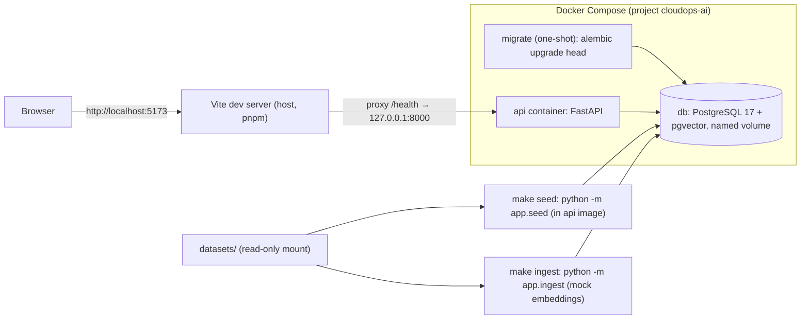
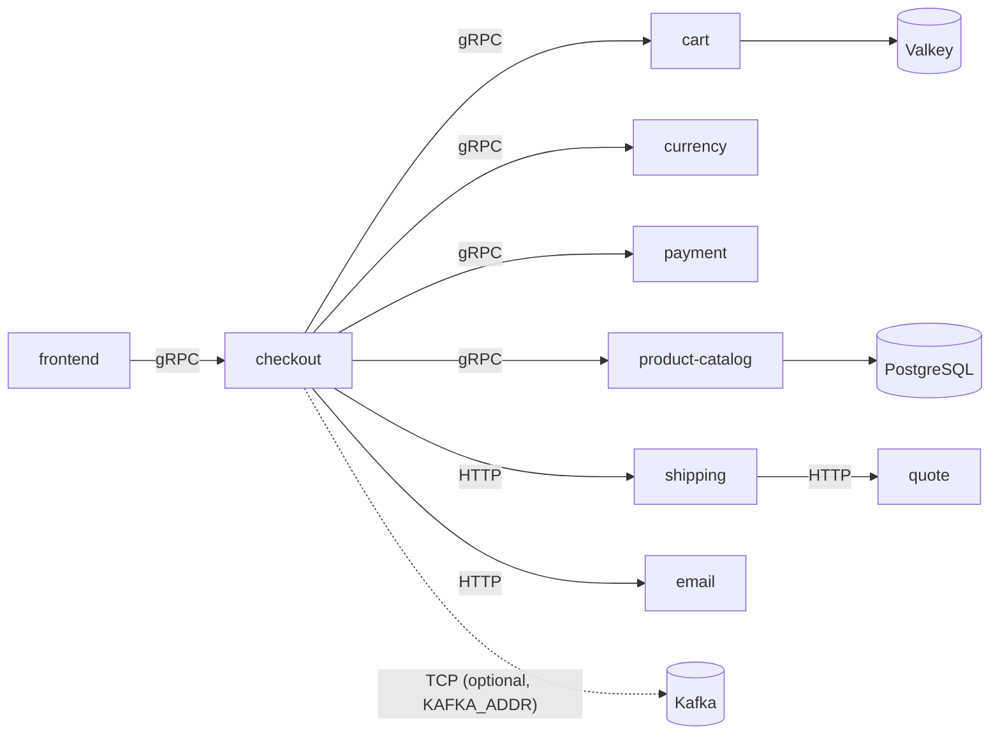

# Architecture

This page separates what is **implemented** (Week 1) from the **target**
architecture in [PROJECT_PLAN.md](PROJECT_PLAN.md). Anything under "Target" is
planned and does not exist yet.

## Implemented: local stack (Week 1, Week 2 through phase 2C)



Startup order: `db` becomes healthy, then `migrate` runs and must exit 0
(`service_completed_successfully`), then `api` starts. `make up` waits until
the API's own healthcheck (`/health/live`) passes.

### Health semantics

| Endpoint | Touches DB | 200 when | Otherwise |
| --- | --- | --- | --- |
| `/health/live` | No | The process serves requests | n/a |
| `/health/ready` | Yes | `SELECT 1` works and the `vector` extension is installed, within `READINESS_TIMEOUT_SECONDS` | `503 {"status":"unavailable","checks":{...}}`, with no connection details in the body. The error type is logged. |

Connections use asyncpg `timeout` and `command_timeout`, plus a pool timeout and
`pool_pre_ping`. A hung or crashed database therefore yields a prompt 503
instead of a hanging request, and readiness recovers by itself when the
database returns.

### Data model

```mermaid
erDiagram
    services ||--o{ documents : "service_slug (nullable)"
    documents ||--o{ document_versions : "document_id"
    document_versions ||--o{ chunk_sets : "document_version_id"
    ingestion_runs ||--o{ chunk_sets : "ingestion_run_id"
    chunk_sets ||--o{ document_chunks : "chunk_set_id"
    services { string slug PK; string name; string language; text role }
    documents { uuid id PK; string source_key UK; string title; string kind; text source_url }
    document_versions { uuid id PK; uuid document_id FK; string source_revision; string content_sha256; text application_reference; string license; date retrieved_on }
    ingestion_runs { uuid id PK; string status; string chunker_version; string embedding_model; int chunks_written; text error }
    chunk_sets { uuid id PK; uuid document_id FK; uuid document_version_id FK; string chunker_version; string embedding_model; int embedding_dim; bool is_active }
    document_chunks { uuid id PK; uuid chunk_set_id FK; int index; text text; text_array heading_path; int start_line; int end_line; vector_1024 embedding }
```

- A document's identity is its logical source (`source_key`). Each retrieved
  revision is a `document_versions` row, unique per `(document_id,
  source_revision)`.
- `content_sha256` deduplicates: identical content under a new revision keeps
  the first-seen version row (unique per `(document_id, content_sha256)`).
- IDs are UUIDv5 values derived from stable keys, so reseeding keeps every
  identifier.
- `source_revision` is the docs repository commit.
  `application_reference` records the demo version those docs describe. The
  two are tracked separately.
- Chunks live in `chunk_sets`: the full output of one chunker version and one
  embedding model for one document version. A partial unique index allows one
  active set per document. Ingestion writes a new set and switches the active
  flag in one transaction, so a failed run leaves the previous set in place.
- `document_chunks.embedding` is `vector(1024)`, fixed in migration `0002`.
  Only Markdown is ingested; other formats are rejected explicitly. See
  [ADR 003](adr/003-chunk-storage-and-embeddings.md).
- Embeddings currently come from a deterministic mock provider. They have no
  semantic meaning.

### Corpus and evaluation boundaries

- `datasets/corpus/`: material that later weeks will ingest and may show to a
  model.
- `datasets/evaluation/`: questions and expected answers, never ingested.
  Fault-injection guides, scenario solutions, and adversarial payloads also stay
  outside the corpus.

### Reference system: OpenTelemetry Demo checkout path

Verified from the demo's architecture page and `src/checkout/main.go`
(`opentelemetry-demo@b825c7c`):



The demo itself is not run by this repository yet.

## Target (planned, not implemented)

From PROJECT_PLAN §3. These are planned components:

- **Week 2 onward:** ingestion pipeline (parse, chunk, embed), hybrid
  retrieval (pgvector + PostgreSQL full-text search with RRF), citation
  validation.
- **Week 4:** a single bounded LangGraph investigation workflow with typed,
  read-only tools, persisted jobs, leases, and checkpoints. See
  [ADR 002](adr/002-single-bounded-agent.md).
- **Weeks 2 and 4:** Amazon Bedrock adapters for generation (Converse) and
  embeddings.
- **Week 5:** Cognito authentication and per-resource authorization.
- **Week 6:** AWS deployment. CloudFront + S3 frontend, ALB, one ECS Fargate
  task, private RDS PostgreSQL, Secrets Manager, CloudWatch, all provisioned by
  Terraform and deployed via GitHub Actions OIDC.
- **Week 7:** human approval for simulated remediation, and OpenTelemetry
  tracing.

The cloud topology diagram in PROJECT_PLAN §3 is the current intent. It will be
revised when Week 6 starts.
